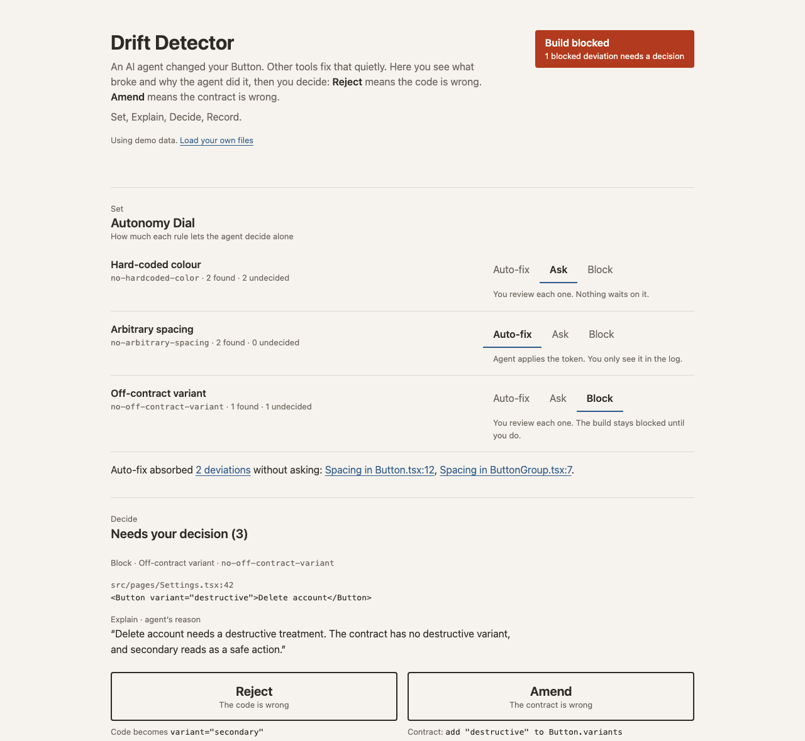

# Drift Detector

A review tool for design-system drift caused by AI coding agents.

**Live:** https://drift-detector-psi.vercel.app



## Why

Detecting drift is a solved problem: linters already flag hard-coded colours, off-scale spacing and off-contract variants. Most tools then fix the code automatically. But an auto-fix hides a decision. Sometimes the agent was wrong, and sometimes the agent found a real gap in the design system.

Drift Detector shows a person what broke and the reason the agent gave, then asks them to decide which side is wrong:

- **Reject:** the code is wrong. It gets the suggested token.
- **Amend:** the contract is wrong. A contract change is proposed.

Every outcome is recorded, including the ones the agent absorbed without asking.

## How it works: Set, Explain, Decide, Record

| Step | What it is |
|---|---|
| **Set** | The Autonomy Dial. Each lint rule is set to **Auto-fix** (absorbed silently, logged), **Ask** (reviewed, nothing waits) or **Block** (reviewed, and the build stays blocked until it is). |
| **Explain** | The agent's stated reason sits on every deviation. A missing reason is shown in the same place, in warning red. |
| **Decide** | Reject or Amend. The two buttons are deliberately identical so the interface doesn't suggest an answer. Amending a change the agent didn't explain requires a note from you. |
| **Record** | A decision log of every outcome, auto-absorbed ones included, exportable as JSON. |

Planned for v2: **Declare** (the agent states intent before generating) and **Calibrate** (a confidence signal per deviation).

## Try the demo

The page opens with a seeded scenario: one rule on each dial setting.

1. The build is blocked by an off-contract `variant="destructive"` on a Delete account button. Read the agent's reason, then decide whether the contract should gain a destructive variant.
2. Two hard-coded colours are waiting. One has a reason; the other doesn't, so Amend requires a note.
3. Two spacing fixes were absorbed by Auto-fix. The line under the dial links to them in the log.
4. Change any dial. Only undecided deviations are re-evaluated.
5. Export the log.

## Use your own files

Under **Your data** at the bottom of the page, drop or choose a JSON file for any of the four inputs. Files you don't replace keep using the demo data. Each file is checked before it's used, and problems are listed in plain language under that file; a file with problems is never applied. Loading a file starts a new review, so export the log first if you want to keep it. **Reset to demo data** restores all four.

**`contract.json`**: the design system. Tokens plus one component contract. Must not contain dial settings.

```json
{
  "tokens": { "color": { "primary": "#2563EB" }, "spacing": { "2": "8px" }, "radius": { "md": "8px" } },
  "component": {
    "name": "Button",
    "variants": ["primary", "secondary"],
    "allowedTokens": { "color": ["color.primary"], "spacing": ["spacing.2"], "radius": ["radius.md"] }
  }
}
```

**`policy.json`**: the default dial for each rule. Rules not listed fall back to Ask, never Auto-fix.

```json
{ "dials": { "no-hardcoded-color": "ask", "no-arbitrary-spacing": "auto-fix", "no-off-contract-variant": "block" } }
```

**`lint-report.json`**: the deviations to review.

```json
{
  "deviations": [
    { "id": "dev-001", "rule": "no-hardcoded-color", "file": "src/components/Button.tsx", "line": 18,
      "snippet": "background-color: #3B82F6;", "suggestedToken": "color.primary" }
  ]
}
```

**`reasons.json`**: the agent's reason for each deviation, keyed by id. A missing id means "No reason given".

```json
{ "dev-001": "Matched the hero CTA colour in the marketing mock." }
```

Contract and policy are separate files on purpose. The contract describes the design system, and the policy describes how much the agent may decide alone. Amend only ever proposes contract changes, so it can't loosen the agent's own oversight.

## Run locally

No build step. Any static server works; the page fetches its demo data, so it won't run from `file://`.

```sh
npm run serve        # python3 -m http.server 8000, then open http://localhost:8000
npm install          # only needed for tests
npm test             # Vitest, 42 tests on src/core
```

## Project structure

```
index.html, styles.css   page and styles (light theme, design tokens as CSS custom properties)
src/core/                pure logic, no DOM: session, decisions, proposals, file validation
src/ui/                  HTML templates (render.js) and event wiring (app.js)
data/                    demo contract, policy, lint report and reasons
test/                    Vitest tests for src/core
docs/                    screenshots
```

## Deploy

Vercel deploys `main` through the Git integration. `vercel.json` skips install and build, so `node_modules` never ships, and serves the repo root as static files. `.vercelignore` keeps tests, docs and repo notes out of the deployment.

## Accessibility

- Keyboard-operable throughout, with a skip link and a visible focus indicator on every stop.
- Focus is kept or moved deliberately when the page re-renders.
- One live region for the build status and one for decision, dial and file-load announcements.
- All text meets WCAG AA contrast.
- Verified with a scripted keyboard-only walkthrough using trusted key events. Not yet tested with a screen reader.

## More

- [`BUILD_LOG.md`](BUILD_LOG.md): what was built in each phase and why, including decisions that were later reversed.
- [`CLAUDE.md`](CLAUDE.md): the working spec and the decisions so far.
